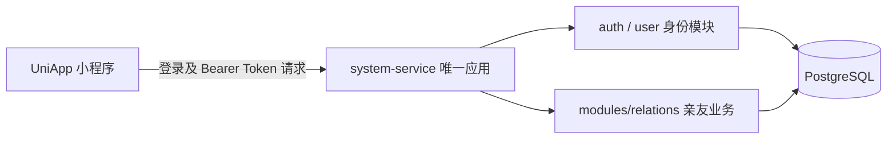

# 礼账项目 Java 后端接口与数据库规划

日期：2026-10-16。

状态：礼账业务仍为方案草案，尚未新增家庭、记账等 Java 业务代码及迁移。当前已提供邮箱验证码注册、密码登录和手机号绑定后端，实际 SMTP、PostgreSQL 与小程序联调仍需配置后验证。

前端：`F:\公司项目\gitee\business\giftLedger\gift-ledger`。

后端：`F:\公司项目\gitee\base-mybatis-plus-service`，由用户明确指定使用现有工程。

文档归属：统一维护在当前后端工程 `docs/Java后端接口与数据库规划.md`，由前端工程迁入，前端不保留重复副本。

阅读约定：前端现状与接入改造章节中的 `src/`、`mock/` 路径相对于上述前端工程；Java 模块及 `sql/` 路径相对于当前后端工程。微信登录、旧账导入及未结清亲友删除等未定事项仍为方案建议，迁移文档不代表批准实施。

架构更新：用户已于 2026-10-16 确认改为单服务。本文同步服务落点；原有家庭、人情、借贷等业务规划仍未实施。

认证更新：首版使用邮箱验证码注册并设置密码，邮箱或绑定手机号加密码登录；手机号登录后填写绑定，暂不短信验证。实现与接口以 [邮箱注册与密码登录](Java学习/04_邮箱注册与密码登录.md) 为准。本文后续微信身份表和微信登录部分保留为未来可选方案，不属于当前首版实现。

## 1. 规划前提与建议

1. 沿用现有 JDK 21、Spring Boot 3.5.16、MyBatis-Plus 3.5.17、PostgreSQL、Flyway，不切换 MySQL。
2. 使用 `system-service` 一个运行服务，账号登录与礼账业务在同一应用内按模块组织；亲友业务放在 `com.base.system.modules.relations` 下，不再通过 HTTP 查询另一服务的身份。
3. 以家庭为数据归属单位；单人也通过单人家庭记账。一人最多一个家庭，一家最多两名成员，成员平等管理家庭数据。
4. 人情、借贷、家庭收支分别保存，分别统计。它们不会自动生成另一类记录，也不会自动算成银行资产余额。
5. 首版采用邮箱验证码注册、邮箱或手机号加密码登录；微信登录延后，当前实现见上方认证更新。
6. 正式用户初始账目为空，只初始化家庭收支默认分类；不把本机演示账号和示例账目搬进正式用户数据。
7. 本机旧数据是否需要导入尚未确认。本文列出导入边界，不默认把本机缓存认定为真实账号数据。

已确定的实现方式：保留 `base-common`、`base-security` 两个公共类库，唯一启动入口为 `SystemApplication`（默认 8080）；礼账功能作为 system 内部业务模块开发，直接复用现有持久化、事务和认证能力。

## 2. 当前前端实际具备什么

| 模块 | 已实现行为 | 主要源码 |
| --- | --- | --- |
| 首页 | 已记录存款合计、本月收入/支出/结余、本月存下、待收/待还、近六月收支趋势、本月支出分类前三名、本月收礼/送礼、最近五笔综合记录、记账入口 | src/pages/index/index.vue |
| 亲友 | 新增、修改、删除、姓名/称谓搜索、人情汇总、借贷差额、详情中的人情时间线 | src/pages/friends/index.vue；src/pages-sub/friends/ |
| 人情 | 十种事件、收礼/送礼、亲友选择、未选亲友时一起新建、收礼可选账簿 | src/pages-sub/record/gift-form.vue |
| 账簿 | 新增、修改、删除、收礼总额和笔数；删除后记录保留为未归属 | src/pages-sub/record/books/ |
| 借贷 | 借出、收款、借入、归还；按亲友累计待收/待还，还款校验 | src/components/loan-record-form/ |
| 家庭收支 | 收入、支出、存款；新增、修改、删除；月/年汇总、分类占比与分类明细 | src/pages/loans/index.vue；src/pages-sub/household/；src/pages-sub/record/house-form.vue |
| 收支分类 | 收入/支出分类新增、改名、图标、同方向上移、停用/启用、未使用分类删除 | src/components/household-category-editor/；src/pages-sub/household/categories.vue |
| 家庭共享 | 创建家庭、邀请、预览、加入、带入/清除旧家庭数据、退出、清空历史 | src/pages-sub/family/index.vue |
| 我的 | 家庭管理、账簿入口、亲友/账簿/记录数量、静态帮助和关于 | src/pages/mine/index.vue |

当前调用链：

```text
页面 → Pinia store → src/api/giftLedger.ts / family.ts
                         ↓
                 mock/giftLedger.ts / family.ts
                         ↓
               本机 gift-ledger-local 存储
```

现有数据契约已经适合逐步换成异步 HTTP，但还不等于具备真实登录、服务端权限或跨设备同步。

需要特别区分的现状：

- `pages/loans/index.vue` 现在展示的是家庭收支，不能只按目录名把它设计成借贷列表。
- 人情与借贷当前只有新增契约，没有修改/删除契约；第一版不额外增加这两类记录的编辑、撤销或核销功能。
- 亲友详情目前只展示该亲友的人情时间线，借贷差额出现在亲友列表中。
- 账簿目前是收礼记录的可选归属，不是所有家庭账目的容器。
- 首页已直接展示礼账业务，原首页装修接口不在当前首页主调用链。
- `src/api/home.ts` 仍保留装修接口，分类页及旧组件仍会使用部分配置请求；`src/api/mobileTabBar.ts` 也保留旧接口，但当前 tabbar 已使用本地固定五项导航。
- AI 对话和工具页只有占位内容，商品瀑布流和装修组件属于模板保留能力，不能据此推导需要 AI、商城或运营后台业务表。

## 3. 现有 Java 工程能复用什么

| 模块 | 当前已有 | 本次后端开发需要补充 |
| --- | --- | --- |
| base-common | ApiResponse、PageResult、参数校验、异常包装、时间格式、请求日志、健康检查 | 原则上直接复用 |
| base-security | RS256 公钥验签、当前用户、接口权限、安全错误处理 | 直接复用，家庭归属校验放业务层 |
| system-service，默认 8080 | 邮箱/密码登录、用户、角色、菜单、权限、私钥签发 Token、本地身份查询、MyBatis-Plus、PostgreSQL、Flyway | 微信身份绑定与登录、可重复的展示昵称，以及 modules/relations 下的家庭及记账模块 |

礼账业务复用 system 的现有数据源、Mapper 扫描和事务配置；实际业务仍需新增 Entity、Mapper、Service、Controller 和迁移脚本。

现有 system 数据表为 8 张：

```text
relations.sys_user
relations.sys_role
relations.sys_permission
relations.sys_menu
relations.sys_user_role
relations.sys_role_permission
relations.sys_menu_role
relations.sys_menu_button
```

这些是已有账号权限表，本次不重复创建。`relations` 在这里是既有数据库 schema 名，不代表还存在独立的 relations-service。

建议新增 10 张表：身份模块管理 1 张微信身份表；亲友业务模块管理 9 张家庭记账表，均由 system-service 执行读写与迁移。完整落地后为已有 8 张 + 新增 10 张，共 18 张业务/身份表，不计 Flyway 历史表。

## 4. 模块和数据边界



- 同一个应用使用同一个 PostgreSQL 数据源，身份和业务代码通过本地方法调用协作。
- 账号表保留 `relations` schema；礼账表仍建议使用 `gift_ledger` schema 区分数据，统一由 system 的 Flyway 执行，沿用 `relations.flyway_schema_history`。
- 安全模块本地读取最新身份与权限；亲友业务通过认证主体取得当前用户，不再使用 `/auth/access` 远程查询。
- 业务表中的 `user_id`、`created_by` 沿用当前身份的 INTEGER，不为此把现有用户 ID 全部改成 BIGINT。
- 家庭内的关联由业务事务与同家庭校验保证；原规划暂不对业务 user_id 增加身份表外键，单服务合并不额外改变这一数据约束。
- 普通用户能管理自己所在家庭的数据；超级管理员身份不能自动跳过家庭归属校验。当前方案不增加管理员查看全站账目的入口。

## 5. 数据表总览

| 序号 | 表名 | 所属模块 | 用途 |
| --- | --- | --- | --- |
| 1 | relations.sys_user_wechat | 身份模块 | 微信身份与统一用户的绑定 |
| 2 | gift_ledger.family | 亲友业务模块 | 家庭 |
| 3 | gift_ledger.family_member | 亲友业务模块 | 当前家庭成员关系 |
| 4 | gift_ledger.family_invitation | 亲友业务模块 | 邀请码、有效期与使用状态 |
| 5 | gift_ledger.friend | 亲友业务模块 | 家庭共享的亲友档案 |
| 6 | gift_ledger.gift_book | 亲友业务模块 | 收礼账簿 |
| 7 | gift_ledger.gift_record | 亲友业务模块 | 收礼/送礼流水 |
| 8 | gift_ledger.loan_record | 亲友业务模块 | 借出/收款/借入/归还流水 |
| 9 | gift_ledger.household_category | 亲友业务模块 | 家庭收入、支出、存款分类 |
| 10 | gift_ledger.household_record | 亲友业务模块 | 家庭收入、支出、存款流水 |

第一版不额外建余额表、统计结果表、银行账户表、利息表、分期表或逐笔还款分配表。现有余额和统计均可以从流水汇总得出。

### 5.1 通用字段与类型

- 新表主键建议使用 PostgreSQL `BIGINT GENERATED BY DEFAULT AS IDENTITY`，Java 使用 Long；向礼账前端返回字符串 ID。当前统一用户 ID 仍为 Integer，在家庭与记账响应 DTO 中将用户 ID、createdBy 适配为前端要求的字符串，不改现有安全主体类型。
- 家庭归属表都保存 `family_id BIGINT NOT NULL`，查询、修改、删除必须同时限定家庭与对象 ID。
- 新表保存 `created_at`、`updated_at`，类型为 `TIMESTAMP WITH TIME ZONE`，Java 使用 Instant。
- 三类记录额外保存 `created_by INTEGER` 和 `created_by_name VARCHAR(100)`，保留原记录人及当时显示名称；修改记录不替换原作者。
- 业务日期使用 `DATE`，Java 使用 LocalDate，JSON 保持 `YYYY-MM-DD`；不拿 created_at 代替业务日期。
- 金额为 `amount_cents BIGINT NOT NULL`，Java 使用 Long，单位为分，必须是正整数。禁止 float/double 保存金额。
- 金额仍按前端的 `amountCents` 数值返回；实现时需约定单笔及汇总范围，确保不会超过 JavaScript 安全整数范围。
- 表中的无关联使用 NULL；API 适配层继续把可空 friendId/bookId 转换为前端当前的空字符串。
- 新业务表先按现有行为物理删除；不擅自增加软删除或回收站。保留历史通过解除档案关联和保存快照实现。

### 5.2 sys_user_wechat：微信身份表

| 字段 | 类型 | 说明 |
| --- | --- | --- |
| id | BIGINT | 主键 |
| user_id | INTEGER | 绑定的现有 sys_user.id |
| app_id | VARCHAR(64) | 微信小程序 AppID |
| open_id | VARCHAR(128) | 当前 AppID 下的微信身份 |
| union_id | VARCHAR(128)，可空 | 微信实际返回时保存，不作为本版必填项 |
| created_at / updated_at | TIMESTAMPTZ | 创建及修改时间 |

约束：`UNIQUE(app_id, open_id)`；`UNIQUE(user_id, app_id)`。不把 union_id 当作小程序必定能拿到的字段，也不自动跨应用合并账号。

现有 sys_user 要做的增量：

1. 增加可空 `nickname VARCHAR(100)`，用于可重复的用户显示名称；username 保留现有唯一账号标识用途。
2. 目前 email、phone、password 都是 NOT NULL 且前两者唯一，不能直接创建没有邮箱、手机号、密码的微信用户。
3. 建议允许这三个字段为空，仅微信登录创建的账号使用空值；原邮箱注册/登录 DTO 继续保留原必填校验，密码登录显式拒绝未设置密码的账号。
4. 微信新账号由服务端生成唯一 username，设置普通用户身份；不创建假的邮箱、手机号或默认密码，不接受客户端指定角色及管理员标识。
5. 复用 system 的 RS256 签发逻辑；缺少邮箱时不强塞 email JWT claim。首次登录创建用户与微信绑定必须在一个事务中完成。

这是建议的账号扩展方案，尚未执行数据库变更。若业务要求微信必须绑定手机，应先改变登录流程，再落此表结构。

### 5.3 family：家庭表

| 字段 | 类型 | 说明 |
| --- | --- | --- |
| id | BIGINT | 家庭 ID |
| name | VARCHAR(100) | 家庭名称 |
| created_by | INTEGER | 最初创建人，仅作来源记录，不代表户主权限 |
| created_at / updated_at | TIMESTAMPTZ | 时间 |

成员数、记录总数、是否有数据均实时查询，不在此重复保存。家庭没有管理员与普通成员之分。

### 5.4 family_member：家庭成员表

| 字段 | 类型 | 说明 |
| --- | --- | --- |
| id | BIGINT | 主键 |
| family_id | BIGINT | 家庭 ID |
| user_id | INTEGER | 统一用户 ID |
| created_at / updated_at | TIMESTAMPTZ | 加入及修改时间 |

约束：`UNIQUE(user_id)`，直接保证一人最多一个当前家庭；另建 family_id 索引。

一家最多两人通过锁定家庭后检查人数实现，不能仅靠“先查人数再插入”。退出时删除当前成员关系，历史流水仍保留原作者。

### 5.5 family_invitation：邀请码表

| 字段 | 类型 | 说明 |
| --- | --- | --- |
| id | BIGINT | 主键 |
| family_id | BIGINT | 被邀请加入的家庭 |
| code | VARCHAR(8) | 唯一的八位邀请码 |
| inviter_id | INTEGER | 邀请人 |
| status | VARCHAR(16) | pending / used / revoked |
| expires_at | TIMESTAMPTZ | 24 小时有效期 |
| used_by | INTEGER，可空 | 实际接受人 |
| used_at | TIMESTAMPTZ，可空 | 实际使用时间 |
| created_at / updated_at | TIMESTAMPTZ | 时间 |

约束：code 唯一。过期直接按 expires_at 判断，不需要为此增加定时任务。可使用 PostgreSQL 部分唯一索引限制每个家庭最多一条 pending 记录；生成前先撤销旧 pending 记录，包括已过期但尚未改状态的记录。

前端现有 expiresAt 是毫秒时间戳，响应 DTO 单独输出 epoch 毫秒，不能直接套全局 Instant 字符串格式。

### 5.6 friend：亲友档案

| 字段 | 类型 | 说明 |
| --- | --- | --- |
| id / family_id | BIGINT | 主键与家庭归属 |
| name | VARCHAR(100) | 姓名，必填 |
| appellation | VARCHAR(100)，可空 | 称谓 |
| gender | VARCHAR(10)，可空 | male / female；未填写在 API 返回空字符串 |
| note | TEXT，可空 | 备注 |
| created_at / updated_at | TIMESTAMPTZ | 时间 |

亲友姓名不设唯一约束。同名亲友靠 ID 区分，不能用姓名把两个人的账自动合并。

删除亲友时在同一事务内：保留所有人情与借贷流水及姓名/称谓快照，把匹配的 friend_id 置 NULL，再删除档案。

### 5.7 gift_book：收礼账簿

| 字段 | 类型 | 说明 |
| --- | --- | --- |
| id / family_id | BIGINT | 主键与家庭归属 |
| name | VARCHAR(100) | 名称 |
| biz_date | DATE，可空 | 账簿日期，映射前端 date |
| note | TEXT，可空 | 备注 |
| created_at / updated_at | TIMESTAMPTZ | 时间 |

账簿不设姓名式唯一规则。删除时仅解除人情流水 book_id，不能级联删除流水。账簿汇总只计算关联的 received 记录。

### 5.8 gift_record：人情流水

| 字段 | 类型 | 说明 |
| --- | --- | --- |
| id / family_id | BIGINT | 主键与家庭归属 |
| friend_id | BIGINT，可空 | 亲友档案；删除档案后为空 |
| book_id | BIGINT，可空 | 收礼账簿；未选择或删除后为空 |
| event_type | VARCHAR(20) | 事件类型 |
| direction | VARCHAR(16) | received 收到 / sent 送出 |
| name | VARCHAR(100) | 记账时姓名快照 |
| appellation | VARCHAR(100)，可空 | 记账时称谓快照 |
| amount_cents | BIGINT | 金额，分 |
| biz_date | DATE | 业务日期 |
| note | TEXT，可空 | 备注 |
| created_by / created_by_name | INTEGER / VARCHAR(100) | 记录人及显示名称快照 |
| created_at / updated_at | TIMESTAMPTZ | 时间 |

事件枚举沿用前端：wedding、baby、visit、new-year、birthday、school、house、longevity、funeral、other。第一版使用枚举校验，不单独建事件类型表。

有 friendId 时校验其属于当前家庭；无 friendId 时新建亲友与写流水同事务完成。快照保留表单本次输入，修改本笔称谓不修改档案。已有 friendId 与姓名矛盾时应拒绝并要求重新选择，避免把账记到另一个人名下。送礼时 book_id 归空，保持当前页面规则。

### 5.9 loan_record：借贷流水

| 字段 | 类型 | 说明 |
| --- | --- | --- |
| id / family_id | BIGINT | 主键与家庭归属 |
| friend_id | BIGINT，可空 | 亲友档案；删除档案后为空 |
| direction | VARCHAR(16) | lend / receive / borrow / pay |
| name / appellation | VARCHAR(100) | 姓名与称谓快照，称谓可空 |
| amount_cents | BIGINT | 金额，分 |
| biz_date | DATE | 业务日期 |
| note | TEXT，可空 | 备注 |
| created_by / created_by_name | INTEGER / VARCHAR(100) | 记录人及名称快照 |
| created_at / updated_at | TIMESTAMPTZ | 时间 |

不保存 original_loan_id，不逐笔核销，不做利息与分期。

```text
每个亲友的待收 = SUM(lend) - SUM(receive)
每个亲友的待还 = SUM(borrow) - SUM(pay)
```

两者分别展示，不自动抵销。亲友列表的借贷差额可以显示“待收 - 待还”，但该差额不能用作收款或归还的限额。

收款/归还必须使用有效的已有亲友，金额不得超过对应总余额；服务端必须在事务与数据库锁保护下重新计算，不能信任客户端余额。

### 5.10 household_category：家庭收支分类

| 字段 | 类型 | 说明 |
| --- | --- | --- |
| id / family_id | BIGINT | 主键与家庭归属 |
| record_type | VARCHAR(10) | expense / income / saving，映射前端 type |
| name | VARCHAR(12) | 分类名 |
| icon | VARCHAR(32) | 前端支持的图标代码 |
| active | BOOLEAN | 是否可用于新增记录 |
| sort_no | INTEGER | 同一方向的排序 |
| created_at / updated_at | TIMESTAMPTZ | 时间 |

新家庭初始化当前默认分类：餐饮、房租、房贷、还花呗、父母养老、日用、其他、工资、额外收入、其他收入、存款。每个家庭生成独立分类 ID，不继续把 expense-food 等字符串当数据库主键。

当前仅收入/支出分类支持维护；saving 使用内置存款分类，不开放自定义、删除或上移。

分类名 1～12 字，同一家庭、同方向新增/改名不允许重名，包含已停用分类。家庭合并可以保留两边原有同名分类，因此不能直接增加 `UNIQUE(family_id, record_type, name)`：正常维护由服务层在家庭写锁下校验，合并形成的同名项允许原名不变时改图标和启停。

已有记录的分类只能停用，不能删除。分类改名后历史记录显示新名称，因此流水不保存分类名快照。

### 5.11 household_record：家庭收支流水

| 字段 | 类型 | 说明 |
| --- | --- | --- |
| id / family_id | BIGINT | 主键与家庭归属 |
| record_type | VARCHAR(10) | expense / income / saving，映射前端 type |
| category_id | BIGINT | 当前家庭对应方向的分类 |
| amount_cents | BIGINT | 金额，分 |
| biz_date | DATE | 业务日期 |
| note | TEXT，可空 | 备注 |
| created_by / created_by_name | INTEGER / VARCHAR(100) | 记录人及名称快照 |
| created_at / updated_at | TIMESTAMPTZ | 时间 |

方向与分类类型必须一致。停用分类不允许新增或切换使用；编辑原本使用该分类的记录时，可以保留原分类并修改金额、日期、备注。

第一版允许修改和删除家庭收支，沿用已有行为；保存后重新查询相关期间汇总，不通过客户端累加猜测云端总额。

### 5.12 关联关系和索引

```text
sys_user ── sys_user_wechat              system 内身份关联
sys_user ── family_member               同一应用内关联，沿用 user_id 和家庭归属校验
family   ── family_member / family_invitation
family   ── friend / gift_book / household_category
family   ── gift_record / loan_record / household_record
friend   ── gift_record / loan_record   档案删除只解除关联
gift_book ── gift_record                账簿删除只解除关联
household_category ── household_record  使用过的分类禁止删除
```

建议基础索引：

| 表 | 索引 |
| --- | --- |
| family_member | UNIQUE(user_id)；INDEX(family_id) |
| family_invitation | UNIQUE(code)；INDEX(family_id, status)；按需增加 pending 部分唯一索引 |
| friend / gift_book | INDEX(family_id, id) |
| gift_record | INDEX(family_id, biz_date, id)；INDEX(family_id, friend_id, biz_date)；INDEX(family_id, book_id) |
| loan_record | INDEX(family_id, friend_id, direction)；INDEX(family_id, biz_date, id) |
| household_category | INDEX(family_id, record_type, sort_no) |
| household_record | INDEX(family_id, biz_date, id)；INDEX(family_id, category_id, biz_date) |

金额正数、方向枚举等同时使用 DTO 校验和数据库 CHECK；不能只依赖页面校验。记录关联对象也要校验同一家庭，不能仅验证 ID 存在。

## 6. 接口规划

沿用当前 Java 的 `GET /模块/list`、`POST /模块/create` 等命名习惯，不单独引入一套 REST 命名风格。

以下是同一个应用内的接口路径，统一访问默认 8080 端口。前端使用同一个后端地址，不再分别配置 `/system/`、`/relations/` 的双服务转发；公网代理前缀在实际部署时统一确定。

接口分为：

- **首版**：支撑当前页面及现有 API 契约。
- **分页阶段**：从一次全量加载转为按页查询时接入。先列明完整目标，但不要求第一轮同时实现全量与分页两套读取。

### 6.1 登录与用户：system-service

| 方法 | 路径 | 状态/用途 | 入参或结果 |
| --- | --- | --- | --- |
| POST | /auth/login | 已有，邮箱密码登录 | 保留现有接口 |
| GET | /auth/userInfo | 已有，用户信息、权限、菜单 | 保留现有结构；小程序做昵称适配 |
| POST | /auth/wechat/login | 首版新增，微信 code 换统一 Token | 入参 code；AppID 与 Secret 来自服务端配置；返回 token |

微信接口必须在 system 显式配置匿名 POST 白名单；其余记账接口均需认证。前端只提交 uni.login 得到的 code，不提交 openid 充当登录凭证，不接收或保存微信 session_key。

本版沿用已有 JWT 会话机制；退出登录先清前端身份和记账缓存，不额外承诺已有 Token 会被全局注销。若需要主动失效所有会话，再单独设计。

### 6.2 家庭：system 内亲友业务模块

| 方法 | 路径 | 用途 | 主要入参/结果 |
| --- | --- | --- | --- |
| GET | /family/state | 首版，当前用户与家庭快照 | currentUser、family、invitation；无体验账号列表 |
| POST | /family/create | 首版，创建家庭 | name；返回家庭快照 |
| POST | /family/invitation/create | 首版，生成或替换邀请 | historyChoice: keep / clear；返回 code、expiresAt |
| GET | /family/invitation/preview | 首版，预览邀请 | code；仅返回家庭名、邀请人、记录数、到期时间 |
| POST | /family/invitation/accept | 首版，接受邀请 | code、historyChoice；返回新家庭快照 |
| POST | /family/leave | 首版，退出当前家庭 | 返回无家庭快照 |
| POST | /family/history/clear | 首版，清空当前家庭历史 | 仅单人家庭允许；返回快照 |

首次正式使用建议在登录后由前端显式调用 create，创建“我的家庭”；GET state 不创建数据。退出家庭后 state 返回 family:null，不能每次读取都自动建回家庭。

预览邀请不会加入家庭，也不会提前清除旧数据。接受邀请必须再次检查有效期、状态、人数和来源家庭，不使用预览时的旧判断。

`createLocalUser` 和 `switchLocalUser` 只属于本机演示，不设计正式 HTTP 接口。

### 6.3 亲友

| 方法 | 路径 | 用途 | 主要入参/结果 |
| --- | --- | --- | --- |
| GET | /friend/list | 分页阶段，列表/选择亲友 | keyword、pageNum、pageSize；含人情汇总与待收/待还 |
| GET | /friend/detail | 分页阶段，档案与汇总 | id；时间线由 gift-record/list 查询 |
| POST | /friend/create | 首版，新增 | name、appellation、gender、note；返回完整档案 |
| POST | /friend/update | 首版，修改 | id + 允许修改字段；返回完整档案 |
| POST | /friend/delete | 首版，删除档案保留流水 | id |

亲友列表建议返回 receivedCents、sentCents、receivedCount、sentCount、balanceCents、lastDate，以及 receivableCents、payableCents，避免客户端为每个亲友单独请求余额。

### 6.4 账簿

| 方法 | 路径 | 用途 | 主要入参/结果 |
| --- | --- | --- | --- |
| GET | /gift-book/list | 分页阶段，管理/选择列表 | keyword、pageNum、pageSize；含 receivedCents、recordCount |
| GET | /gift-book/detail | 分页阶段，编辑前读取 | id |
| POST | /gift-book/create | 首版，新增 | name、date、note；返回完整账簿 |
| POST | /gift-book/update | 首版，修改 | id、name、date、note；返回完整账簿 |
| POST | /gift-book/delete | 首版，删除并解除归属 | id |

### 6.5 人情记录

| 方法 | 路径 | 用途 | 主要入参/结果 |
| --- | --- | --- | --- |
| GET | /gift-record/list | 分页阶段，亲友时间线及筛选 | friendId、bookId、direction、eventType、startDate、endDate、pageNum、pageSize |
| POST | /gift-record/create | 首版，记人情，可同时新建亲友 | eventType、direction、date、friendId、name、appellation、amountCents、bookId、note |

新增返回 `{ record, friend? }`，直接对应当前 addRecord 契约。createdBy、createdByName、familyId 均由服务端写入，不作为可任意提交的业务字段。

人情记录修改/删除暂不列入当前首版，因为页面和 GiftLedgerApi 尚无这些行为。

### 6.6 借贷记录

| 方法 | 路径 | 用途 | 主要入参/结果 |
| --- | --- | --- | --- |
| GET | /loan-record/list | 分页阶段，历史读取/综合记录支撑 | friendId、direction、startDate、endDate、pageNum、pageSize |
| GET | /loan-record/balance | 分页阶段，还款表单实时查余额 | friendId；返回 receivableCents、payableCents |
| POST | /loan-record/create | 首版，四类借贷操作 | direction、friendId、name、appellation、amountCents、date、note |

新增同样返回 `{ record, friend? }`。借出/借入允许同时新建亲友；收款/归还必须选已有亲友。前端余额只作提示，提交时以服务端事务内的余额为准。

第一版不开放借贷流水修改/删除；删除原借出流水可能导致已还金额大于本金，不能顺手套通用 CRUD。

### 6.7 家庭收支记录

| 方法 | 路径 | 用途 | 主要入参/结果 |
| --- | --- | --- | --- |
| GET | /household-record/list | 分页阶段，明细列表 | startDate、endDate、type、categoryId、pageNum、pageSize |
| GET | /household-record/detail | 分页阶段，单笔详情/编辑 | id |
| POST | /household-record/create | 首版，新增 | type、categoryId、amountCents、date、note；返回完整记录 |
| POST | /household-record/update | 首版，修改 | id + 上述字段；返回完整记录 |
| POST | /household-record/delete | 首版，删除 | id |
| GET | /household-record/summary | 分页阶段，月份或年份汇总 | period: YYYY-MM 或 YYYY；可含各月分组 |
| GET | /household-record/trend | 分页阶段，近六月收支趋势 | month: YYYY-MM，作为结束月份；返回连续六个月的 month、incomeCents、expenseCents、balanceCents、savingCents，无流水月份补零 |
| GET | /household-record/category-stats | 分页阶段，分类合计与占比 | period、type；返回分类 ID、名称、金额及占比，按金额倒序；首页请求本月 expense 后取前三项 |

列表翻页不能影响统计总额，summary 和 category-stats 对完整筛选范围计算，不能只汇总当前页。

trend 返回结束月份及之前五个月，按月份升序，不受明细翻页影响。category-stats 的占比以该期间、该方向全部分类的总额为分母，不能改成前三项金额之和；无记录时返回空数组。

### 6.8 家庭收支分类

| 方法 | 路径 | 用途 | 主要入参/结果 |
| --- | --- | --- | --- |
| GET | /household-category/list | 分页阶段，全部/可用分类 | type、active；返回 used 标识便于判断删/停用 |
| POST | /household-category/create | 首版，新增收入/支出分类 | type、name、icon |
| POST | /household-category/update | 首版，改名、图标、启停 | id、name、icon、active |
| POST | /household-category/delete | 首版，删除未使用分类 | id |
| POST | /household-category/move-up | 首版，同方向上移一位 | id；返回完整有序分类数组 |

move-up 返回完整有序数组，保持当前 moveHouseholdCategory 契约；不是只返回被移动的一项。

### 6.9 首页与我的统计

| 方法 | 路径 | 用途 | 主要入参/结果 |
| --- | --- | --- | --- |
| GET | /ledger/overview | 分页阶段，首页汇总 | month: YYYY-MM；存款累计、本月收入/支出/结余/存款、待收/待还、本月收礼/送礼 |
| GET | /ledger/recent | 分页阶段，综合最近记录 | 默认 limit=5；三类流水按业务日期倒序合并 |
| GET | /ledger/data-summary | 分页阶段，我的数据 | friendCount、bookCount、giftRecordCount、loanRecordCount、householdRecordCount、recordCount |
| GET | /ledger/data | 首版，兼容现有 getData | books、friends、records、loanRecords、householdCategories、householdRecords |

首版用 `/ledger/data` 最容易接通现有页面；后续逐页改用列表、余额与统计接口，再停止全量加载。

首页趋势复用 `/household-record/trend`，支出排行复用 `/household-record/category-stats`，不再单独建设排行表或另一套首页统计接口。首版仍由前端根据完整流水计算这些展示。

不能把某个分页列表装进现有 getData 假装“全部记录”，否则当前前端统计、还款提示、分类是否使用判断都会失真。

recent 中保留 recordType 和原 id，组合键用 `recordType + id`，避免不同流水表的自增 ID 相同。日期相同再用 createdAt、recordType、id 确定稳定顺序。

## 7. 接口统一约定和前端改造点

### 7.1 返回格式

沿用 Java 已有：

```json
{
  "code": 0,
  "message": "success",
  "data": {}
}
```

前端当前 `IResData` 和错误提示读取的是 msg，必须统一改为 message；不要为礼账修改 Java 公共响应字段，破坏原管理端契约。

分页沿用 Java 的 PageResult：

```json
{
  "code": 0,
  "message": "success",
  "data": {
    "list": [],
    "total": 0,
    "pageNum": 1,
    "pageSize": 20
  }
}
```

HTTP 400/401/403/404/409/503 等配合现有异常结构使用；http 层需要校验业务 code，不能因为收到 HTTP 2xx 就直接把失败结果当成功。

### 7.2 改造位置

| 前端文件/模块 | 接入时要做什么 |
| --- | --- |
| src/api/giftLedger.ts | 用已有 http 替换 mock，取 response.data，保留保存后的完整对象返回 |
| src/api/family.ts | 接真实家庭接口，去掉正式流程对演示账号切换的依赖 |
| src/types/family.ts | 正式快照不含 localUsers；当前用户显示昵称按真实账号适配 |
| src/types/giftLedger.ts | 读取契约逐步分页化；不要继续把 createdBy 当作可提交身份 |
| src/typings.ts、src/api/helper/http.ts | msg 统一为 message，检查业务 code；当前已有 GET/POST 足够支持本规划 |
| src/api/helper/request.ts | 统一登录 Token、家庭上下文、单个后端应用的访问路径 |
| src/store/user.ts | 保存 system 登录态，处理 401 与退出后的身份清理 |
| src/store/gift.ts、src/store/family.ts | 家庭变化时重置缓存；从云端重新读取，不能只靠 loaded 长期复用旧数组 |
| 页面提示 | 将“保存到本机”“仅本机邀请”等体验文案改成真实行为 |

现有 `/nest/api` 是旧模板的请求约定，http.ts 还会剥离它。Java 接入应明确新的服务路径和环境地址，不要把旧 Nest 前缀原样加到这些 Java 路由上。

### 7.3 家庭上下文与同步

- 身份来自已验证 Token，家庭成员关系每次读取服务端当前数据；不把 familyId 固定在长期 Token 中。
- 建议家庭数据请求携带 `X-Family-Id` 作为本次页面所属家庭的预期上下文。服务端必须同时确认用户仍是该家庭成员，不能因为请求头给了 ID 就直接查询。
- 这样旧家庭表单在用户加入新家庭后再次提交时，会明确失败，避免把旧表单写入新家庭。
- 退出/切换家庭或收到家庭不匹配错误，清除相关 Pinia 数据与未完成的选择状态；不能仅清 Token。
- 首版在进入首页、家庭页、列表以及记账成功返回时重新请求；这提供跨设备共享数据，不承诺 WebSocket 式实时刷新。
- 全量 `/ledger/data` 应在同一个一致性读取范围内取六组数据，避免返回合并前后的混合数据。

## 8. 必须保留的业务口径

### 8.1 统计

```text
人情差额 = 收礼 - 送礼
待收 = 借出 - 收款
待还 = 借入 - 归还
家庭结余 = 收入 - 支出
已记录存款合计 = 全部 saving 流水金额之和
本月存下 = 本月 saving 流水金额之和
```

- 存款不计入支出，也不从“收入 - 支出”反推。
- 礼金、借入、借出、还款不会自动进入家庭收支。
- 已记录存款合计不是银行卡当前余额，不能暗含期初资产、取款与账户间转账。
- 首页近六月趋势包含当前月份及之前五个月，仅用家庭收入、支出绘制柱状图，缺失月份补零；本月支出排行按分类金额降序取前三项，占比分母仍为本月全部支出。
- 首页待收/待还要统计全部保留借贷流水，包含 friend_id 已置空的流水，不能只从现存亲友列表汇总。
- 家庭记录总数只包括三类流水，不把账簿、亲友、分类数量加进去；hasData 还应考虑已有账簿与亲友，保持当前定义。

### 8.2 家庭加入、退出与清空

接受邀请的同一事务包含：

1. 检查并锁定来源/目标家庭，重新核验成员关系、邀请码与人数。
2. 来源是单人家庭且选择 keep：把账簿、亲友、三类流水、分类的 family_id 迁到目标家庭，保留原 ID、作者和关联，不按姓名合并。
3. 选择 clear：仅删除来源家庭数据，目标家庭保留。
4. 删除来源成员关系及已迁空/清空的来源家庭，加入目标家庭，标记邀请码使用并撤销相关旧邀请。
5. 任一步失败则整体回滚。

正式数据库分类使用全局唯一 ID，家庭合并不再有 mock 默认字符串主键碰撞的问题；但仍可能保留同名分类，处理规则保持不变。

收入/支出分类迁入后按原顺序接在目标家庭同方向分类后面，重新安排 sort_no。内置 saving 分类建议复用目标家庭唯一的存款分类，将来源 saving 流水重映射后删除来源内置分类，避免表单出现两个不可维护的“存款”；这不按名称合并自定义收入/支出分类。

退出时有另一成员：该成员保留全部家庭数据；退出者立即失去后续访问权。最后一人退出：清除家庭业务数据、成员及邀请，再删除家庭。

清空历史仅单人成员可执行，范围包含账簿、亲友、三类流水、自定义分类；保留当前账号和家庭，并重新初始化默认分类。所有清空动作均不能留下部分删除结果。

邀请前选择 clear 的行为是立即清空当前单人家庭，再生成邀请；它并不是等待别人接受时才清空，接口与页面确认必须一致。

### 8.3 数据库并发与事务

第一版家庭最多两人，可以采用简单、统一的策略：所有家庭业务写操作先锁定对应 family 行，重新验证成员身份，再读写数据。无需一开始增加 Redis 分布式锁或余额缓存。

- PostgreSQL 默认 READ COMMITTED 下，拿到家庭锁之后再计算借贷余额、分类占用和重复名称；不能在加锁之前读完余额后直接使用旧值。
- 家庭迁入/退出同样使用这套锁。涉及两个家庭时按家庭 ID 固定顺序加锁，并在锁内重新校验状态。
- 生成邀请与接受邀请共用家庭锁，确保邀请码一次使用、家庭人数上限及旧码失效。
- 用户首次创建家庭还要通过成员 user_id 唯一约束兜底，并发创建不能产生两个有效家庭；失败事务整体回滚。
- 创建新亲友与写人情/借贷流水同事务；删除档案与流水关联置空同事务。
- 流水写入与分类停用/删除遵循相同锁顺序，避免校验后关联对象被另一请求删除。

这里的并发正确性必须由真实 PostgreSQL 集成测试验证，现有 mock 的并发测试不能替代数据库验证。

## 9. 代码目录和迁移落点

```text
base-mybatis-plus-service/
├─ system-service/
│  ├─ pom.xml                       登记全部业务迁移脚本，复用持久化依赖
│  └─ src/main/java/com/base/system/modules/
│     ├─ auth/                      扩展微信登录，复用现有签发
│     ├─ user/                      扩展昵称及微信身份实体/Mapper
│     └─ relations/                 同一应用内的亲友业务目录
│        ├─ family/                 家庭、成员、邀请、合并及清空
│        ├─ friend/                 亲友档案
│        ├─ book/                   账簿
│        ├─ gift/                   人情
│        ├─ loan/                   借贷
│        ├─ household/              家庭收支与分类
│        └─ ledger/                 首版全量读取、后续综合统计
└─ sql/
   └─ 1.0.1/                       建议下次发布批次，实施前核对现有版本
      ├─ V2_1__wechat_identity.sql   身份绑定及用户增量字段
      ├─ V2_2__family.sql            家庭；全部脚本均由 system 执行
      ├─ V2_3__family_member.sql
      ├─ V2_4__family_invitation.sql
      ├─ V2_5__friend.sql
      ├─ V2_6__gift_book.sql
      ├─ V2_7__gift_record.sql
      ├─ V2_8__loan_record.sql
      ├─ V2_9__household_category.sql
      └─ V2_10__household_record.sql
```

沿用按功能组织，每个模块按需要放 Controller、Service、DTO、Entity、Mapper；不先搭建没有实际用途的接口/实现层、通用基类或复杂领域框架。

SQL 仍放后端根目录 sql，按表拆分，包含中文表与字段注释；全部由 system-service 的 POM 登记并打包到 `db/system`。

保留 `relations.flyway_schema_history`，统一使用 `classpath:db/system` 执行身份及业务增量脚本。礼账增量中显式创建 `gift_ledger` schema，并使用完整 schema 表名；所有脚本版本全局唯一，不另建第二套迁移历史。

以上版本号只是规划示例，真正实施前读取迁移现状确定；本次不连接数据库修改结构，也不改已执行的 V1 文件。

## 10. 分阶段开发与验收

| 阶段 | 执行内容 | 可验证的完成标准 |
| --- | --- | --- |
| 1. 统一身份 | sys_user 增量、微信绑定、微信登录、前端登录态与 message 对齐 | 同一微信重复登录同一账号；并发首次登录不重复建号；原邮箱登录/权限测试仍通过；同一应用的礼账接口接受该 Token |
| 2. 业务库与单人家庭 | 复用 system 数据源与事务，新增业务迁移、家庭/成员表、默认分类、创建与读取 | 新用户显式创建单人家庭；重启数据保留；无家庭不能写账；跨家庭 ID 访问被拒绝 |
| 3. 人情最小闭环 | 亲友、账簿、人情记录；首版 ledger/data 骨架 | 建亲友→建账簿→收礼→亲友/账簿汇总正确；删除档案只解除关联；保存失败无半条数据 |
| 4. 借贷 | 四类流水与待收/待还校验 | 借出 100 元、收回 30 元后待收 70 元；再收 80 元失败；并发收款总额不能超过 70 元 |
| 5. 家庭收支 | 分类、收入/支出/存款、编辑删除、完善全量读取 | 收入 5000、支出 2000、存款 1000，结余仍为 3000；编辑日期/删除后对应期间统计正确 |
| 6. 两人共享 | 邀请预览/接受、带入/清除、退出、最后一人清理 | 两台设备读取同一家庭；邀请码一次使用；并发加入不超过两人；带入保留作者与关联；任何失败均不清掉来源数据 |
| 7. 查询完善 | 分页、overview/recent、近六月趋势、分类统计及首页排行、我的统计、页面刷新 | 翻页不影响总额；趋势连续六个月且无记录补零；排行占比按全部支出计算；首页包含删除档案后的借贷；旧家庭请求不会写入新家庭；另一成员数据刷新可见 |

每一阶段按“迁移 → Entity/Mapper → 请求/响应 DTO → Service/事务 → Controller → 数据库/HTTP 测试 → 前端接入”执行。

首个推荐练习闭环是：**统一身份接通后，单人家庭 → 新建亲友 → 新建账簿 → 记一笔收礼 → 查看汇总**。这个闭环完成后再加借贷、家庭收支与双人合并，便于逐步学习和定位问题。

## 11. 实施前仍需确定的产品选择

这些不会阻止接口与表的总体规划，但不能在编码时默默选定。

| 事项 | 当前事实 | 建议 |
| --- | --- | --- |
| 微信登录是否强制绑定手机 | 现有小程序无真实登录；系统账号当前要求邮箱、手机号、密码 | 首版微信免填资料登录，身份表绑定统一用户；邮箱/手机号/密码对微信账号允许为空 |
| 是否迁移当前本机账目 | 本机含用户操作和大量演示数据，无法把所有缓存都当正式数据 | 默认正式账号从空白开始；若要保留真实本机记录，另做显式预览与确认导入，不自动上传 |
| 未结清借贷的亲友能否删除 | 当前允许删除并置空 friendId；总欠款保留，但现有表单无法再对这份无档案欠款还款 | 需要在“保留现状”“未结清时阻止删除”“保留可结清的归档身份”之间确定；本次不擅自改变行为 |
| 单笔金额及日期范围 | 页面要求正数、两位小数、有效日期，但没有统一金额上限与未来日期限制 | 实施时明确范围；前后端一致，数据库保存分，不自行增加未来日期禁令 |

本机导入若后续确认需要，应生成旧 ID 到新 ID 的映射，并覆盖账簿、亲友、分类和三类流水关联；本机作者不能直接冒充统一账号，演示记录是否排除也需显式确定。当前不增加导入接口与导入状态表。

## 12. 核验范围与文档迁移记录

- 核对前端 pages.json、五项 tabbar、各业务页面脚本、两组数据类型、API 入口、Pinia、mock 规则与统计工具。
- 核对 Java 父/子模块 POM、服务配置、认证/用户实现、统一响应与分页结构、安全配置、现有 SQL 及迁移归属。
- 原文记录曾使用 Node 执行 7 个现有业务测试文件，共 51 个用例通过，覆盖家庭、家庭收支合并、借贷、收支分类/记录、账簿、亲友管理及首页口径。本次文档迁移未重新运行这些测试，该记录不代表当前代码再次通过验证。
- 上述测试记录仅针对前端/mock 行为，不代表规划中的 Java 接口已经存在，也不代表 PostgreSQL 迁移、真实微信登录或跨设备联调已经通过。
- 2026-10-16：按用户要求将规划从前端 docs 迁入当前后端 docs，删除前端原文件，并在当前 README 增加入口。
- 迁移整理时对照当前首页补充本月收入/支出/结余、近六月趋势、支出前三名及其统计接口、口径与验收项；其余未定产品选择保留原状态。
- 本次仅调整文档；检查迁移结果、文档链接和差异格式，不运行服务、不写入实际数据库。

[返回项目说明](../README.md)
