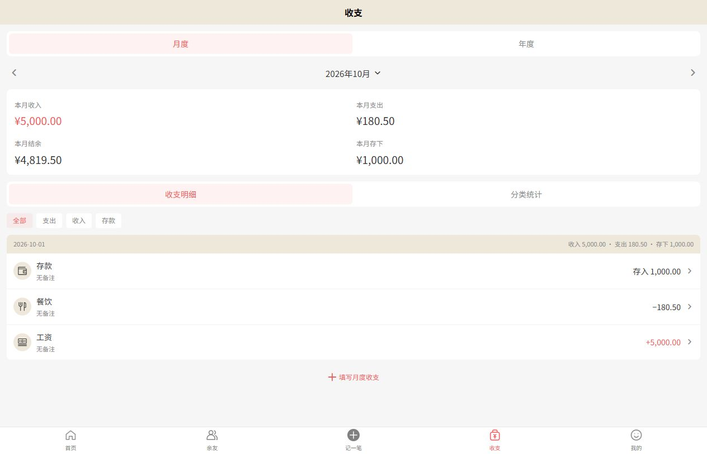
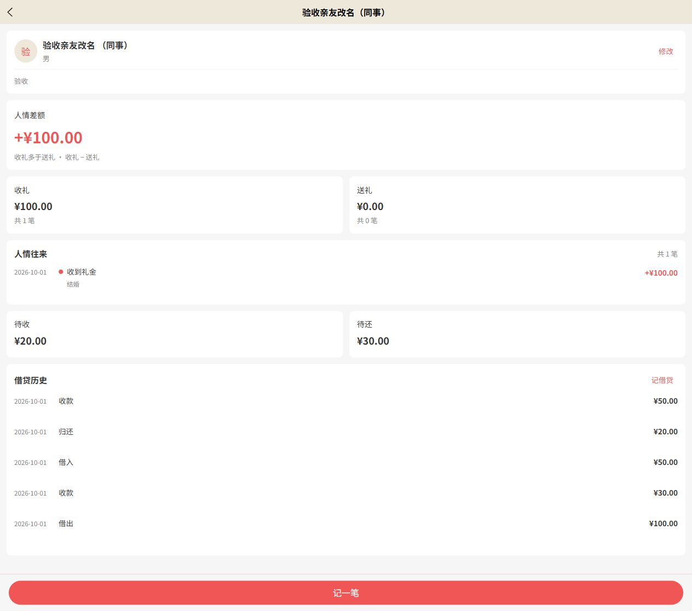
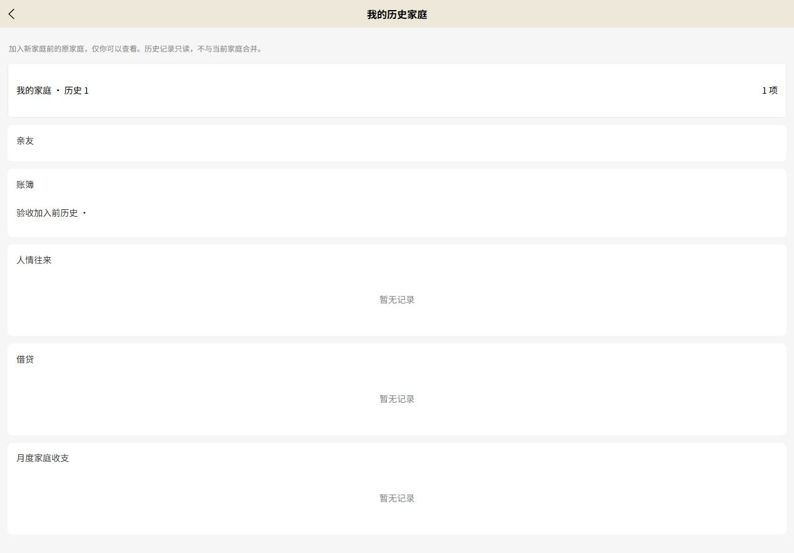

# 礼账开发交付与验收报告

日期：2026-10-23。后端与前端工作区原有未提交改动保留，未提交或推送 Git。

## 交付结论

七阶段业务代码已接通真实 Java 服务和 PostgreSQL，完成本机 HTTP 业务闭环与关键 H5 页面联调，项目类型检查及双端构建通过。前端232项测试中231项通过、0失败、1项外部CMS工程检查明确跳过。真实邮件、微信真机、物理双设备和域名链路尚未验收，不能称为全部环境验收通过。

## 功能与规则

| 阶段 | 已实现内容 | 验证依据 |
| --- | --- | --- |
| 真实服务 / Mock | 显式 mock 才使用模拟响应；local/domain 的登录、家庭和礼账业务走 Java，无 Token、请求失败不回退模拟；API 仅请求，business 处理字段转换，Store 管共享数据 | 模式、API 边界、401/失败测试；真实 H5 登录 |
| 亲友 | 真实分页、姓名搜索、详情、修改、删除；姓名、称谓、性别、备注、ID 契约对齐；整体汇总基于完整数据，不受分页影响 | HTTP 测试、真实 PostgreSQL 及页面搜索 |
| 账簿 / 人情 | 账簿增查改删；收礼/送礼、事件、亲友、收礼账簿归属；新亲友与人情同事务；账簿删除保留流水、解除关联，姓名快照保留 | 真实接口新增、回滚、删除保留及跨家庭检查 |
| 借贷 | 借出、收款、借入、归还；按亲友独立计算待收待还；亲友详情借贷历史；正数整数分、归属、超额和并发校验 | 借100收30余70，再收80返回409；并发仅一笔成功；浮点分400 |
| 月度家庭收支 | 一家庭一月份一张表，表内多分类合计；整月回填、补填、修改；一次提交原子保存；分类增改启停排序及使用中禁止删除；月/年和分类统计 | 唯一月表、整批回滚、多分类接口测试，H5真实回填保存与刷新 |
| 首页 / 我的 | 真实收支、人情、待收待还、累计存款、趋势、分类排行、最近记录、数量；页面返回刷新共享数据；主要页面支持失败重试 | 首页、收支、亲友、我的测试与H5统计核对 |
| 家庭共享 | 所有业务按当前家庭归属校验；家庭两人上限；加入不迁移旧数据，原单人家庭仅原账号只读访问；退出创建新空家庭，原数据留原家庭 | 三个隔离账号的真实邀请、加入、退出、历史访问、跨家庭拒绝与并发测试 |

人情记录首版未增加编辑/删除功能。未结清借贷的亲友禁止删除；结清后删除保留流水姓名快照。没有上传本机旧账，也没有把演示数据导入正式账号。

收入、支出与存款分开统计：结余＝收入－支出，存款为每月存入额；累计存款＝各月存入额之和，不代表实际银行余额。人情金额、借贷余额不并入家庭收支。首页趋势使用实际分类支出，已移除“收入减存款推算支出”的旧公式。

## 数据库迁移

新增并已在本机配置对应的真实 PostgreSQL 执行：

- `sql/1.0.2/V3_4__ledger_books_and_gifts.sql`：账簿、人情流水。
- `sql/1.0.2/V3_5__ledger_loans.sql`：借贷流水。
- `sql/1.0.2/V3_6__monthly_household_ledger.sql`：收支分类、唯一家庭月表、分类月合计。

原已执行脚本未修改。当前 `relations` schema 版本为 3.6，最新服务启动校验 19 项迁移成功。历史家庭复用已有 `hidden_owner` 字段，无需修改历史 SQL。

迁移前备份：`F:\公司项目\数据库备份\base-mybatis-plus-service\2026-10-23_162935_礼账迁移前`，包含 `database.dump`（52188 字节）、`schema.sql`（30102 字节）及 SHA256 校验文件。

## 验证结果

| 检查 | 实际结果 |
| --- | --- |
| Maven 全量测试和 package | 通过；system-service 72 项，base-common 4 项，失败/错误/跳过均为0 |
| 前端全量 Node 测试 | 232 项，231 通过、0 失败、1 跳过；外部CMS工程未安装，本仓库路由断言已独立通过 |
| H5 构建 | 通过，输出 `dist/build/h5` |
| 微信小程序构建 | 通过，输出 `dist/build/mp-weixin`；构建不代表真机验收 |
| TypeScript / vue-tsc | 通过，完整应用源码参与检查；未使用noCheck或忽略诊断 |
| 依赖补丁重放 | 通过；Wot1.14.0类型补丁反向撤销后重新应用成功 |
| git diff --check | 两个工作区均通过 |
| 真实 PostgreSQL HTTP | 通过登录、亲友、账簿、人情事务、借还款、月表、分类、家庭共享/退出/历史和重新登录恢复 |
| 最新服务重启后 | 重新登录恢复历史数据；`amountCents:1.5` 返回400 |
| H5 浏览器 | 验证真实登录、重新登录恢复、亲友搜索/详情、独立待收待还和借贷历史、月表回填与修改、首页统计一致及历史只读页面 |

真实接口脚本：`scripts/礼账真实接口验收.py`；详细结果：`docs/礼账真实接口验收结果.json`；页面证据：`docs/验收截图/`。

脚本使用独立 `ledger-e2e-* @example.test` 账号验证，不使用用户正式账号；密码和 Token 仅保存在本机临时会话文件，未写入仓库报告。注册通过仅监听本机的临时固定验证码实例，随后均在普通8000实例登录和操作；临时18080实例已停止，普通服务未打开验证码测试模式。第一次因URL编码中止的脚本也只产生独立验收账号，未清理用户数据。

真实整月联调发现11分类保存需要11.28秒，超过请求层10秒超时。已合并分类/月表项查询、跳过无变化项、一次更新月表时间，并取消汇总逐项读取月份；相同提交复测3.20秒、汇总读取4.42秒。仅表示本次网络测量。

最终代码复核发现并修复了两个月表问题：连续切换月份时，旧响应可能覆盖当前金额；首次分类加载失败后，重试没有恢复分类。现只有最新月份请求可以回填，重试执行完整加载流程，按记录ID进入的历史月份也在重试后保留，保存期间禁止切月。另外，家庭响应在退出登录后到达时，不再回填已清空的家庭状态。相关回归均先复现失败再验证修复，月表、家庭与收支页面相关18项测试通过，独立复核未发现其他 Critical / Important 问题。

收尾再次以隔离验收账号重新登录普通8000实例，真实月表十月支出仍为18050分，H5返回HTTP200。测试日志保存在本机临时目录的 `gift-final-review-tests.log`、`gift-final-review-types.log`、`gift-final-review-h5.log` 和 `gift-final-review-mp.log`；后端完整构建记录为 `gift-final-maven2.log`。

18:01 最后复核：恢复后的9000开发服务经`/java-api`代理真实登录、读取完整数据与十月月表均返回业务码0，支出仍为18050分；浏览器游客首页及五项导航正常挂载。8000和9000均仅监听127.0.0.1，18080无监听。域名复测仍无法建立SSL连接，未绕过证书校验，继续列为未验收。

类型检查原先的阻塞已解决：开发工具锁定TypeScript5.6.3、vue-tsc2.2.12；仅为实际使用的6种Wot组件声明全局类型，保留所有应用源文件检查；补齐UniApp模板全局、导航元组、选择器结果类型和显式props访问。Wot原有`objToStyle`实现支持字符串，参数声明却遗漏字符串，现以`patches/wot-design-uni+1.14.0.patch`修正一行类型，`postinstall`自动重放。Vue、UniApp、Wot运行时版本未升级，也未修改样式或用忽略诊断消除错误。

依赖目录恢复后，以锁文件执行`npm install`成功，安装脚本自动应用补丁；之后重新跑全量测试、类型检查和双端构建，结果与上表一致。未把因Windows文件占用而失败的`npm ci`记录为通过；安装日志为`gift-dependency-restore.log`。

逐项要求与证据见《礼账需求验收对照.md》。

## 当前限制及剩余验收

1. 外部Nest CMS登记检查需要 `F:\公司项目\gitee\business\nestjs-prisma\nacos\config\cms-pages.json`，本机缺少该可选兄弟工程，测试明确跳过。原断言完整保留；本仓库首页/分类/活动页路由断言独立执行。礼账业务仅依赖Java，该跳过项不证明外部CMS登记正确。
2. 安装前端依赖使用锁文件和正常安装脚本，例如`npm ci`。不要通过`--ignore-scripts`省略Wot类型补丁；若确需跳过脚本，必须手动执行`npm run postinstall`后再检查类型。补丁仅对应Wot1.14.0，升级组件库时需复核并移除或更新补丁。
3. 没有验证真实邮箱收件、验证码投递及限额在真实邮件链路中的表现；本轮账号注册使用隔离验收方式。
4. 没有微信真机及两台物理设备；家庭双身份共享和刷新通过HTTP与自动化测试，不能等同双设备实测。
5. 配置域名 `https://desktop-urpanht.tail440a34.ts.net` 本轮请求发生 HTTPS 握手 EOF，未跳过证书校验。域名可用性、小程序合法域名与公网访问需在相应网络环境复核。当前本机监听地址不能直接供其他设备访问。

## 运行地址与复现

- H5：`http://127.0.0.1:9000`，当前开发服务运行中。
- Java：`http://127.0.0.1:8000`，当前最新可执行包运行中。
- H5 开发 `/java-api` 代理至 `env/.env` 的 `VITE_AUTH_BASEURL=http://127.0.0.1:8000`，避免 localhost 的 IPv6 解析与仅IPv4监听不一致。
- 环境选择仅显式 Mock 使用模拟数据；本地和域名均走同一套真实请求，域名不会自动降级。

构建要求 JDK21、Maven3.9、Node18以上；本机系统默认Java8/Node16不符合要求，本轮使用 `D:\DevTools\jdk-21.0.12.1+1` 与 Codex 自带 Node24，仅修改各命令环境，不更改系统默认配置。

后端根目录：

```powershell
$env:JAVA_HOME='D:\DevTools\jdk-21.0.12.1+1'
$env:Path="$env:JAVA_HOME\bin;$env:Path"
mvn.cmd -s .mvn/settings.xml -B -ntp package
& "$env:JAVA_HOME\bin\java.exe" -jar system-service/target/system-service-0.0.1-SNAPSHOT-exec.jar --spring.config.additional-location=file:./system-service/src/main/resources/application-local.yml --server.address=127.0.0.1 --server.port=8000
```

前端根目录（选择符合版本的Node后）：

```powershell
node --test tests/*.test.cjs
npm.cmd run type-check
npm.cmd run dev:h5 -- --host 127.0.0.1
npm.cmd run build:h5
npm.cmd run build:mp
```

真实验收脚本每次会创建新的隔离账号；再次运行前需按脚本参数提供仅本机开放的验收注册地址，不能对普通注册流程假定固定验证码。报告不包含数据库凭据或测试账号密码。

## 页面证据






